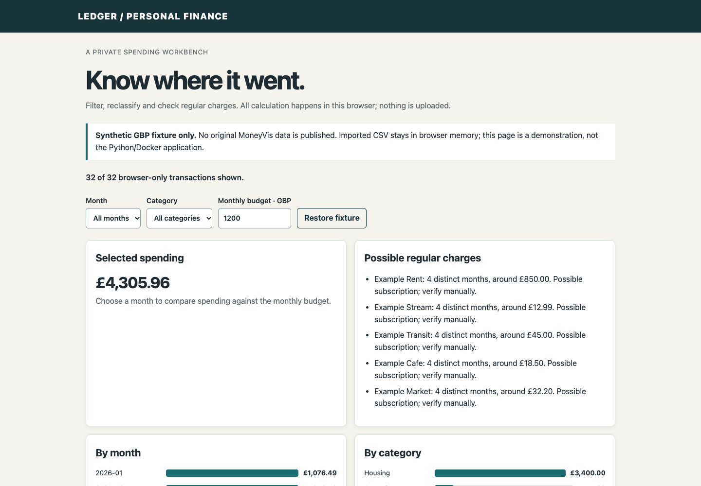
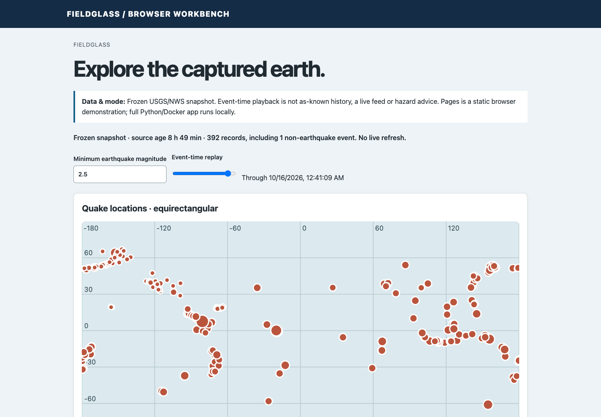
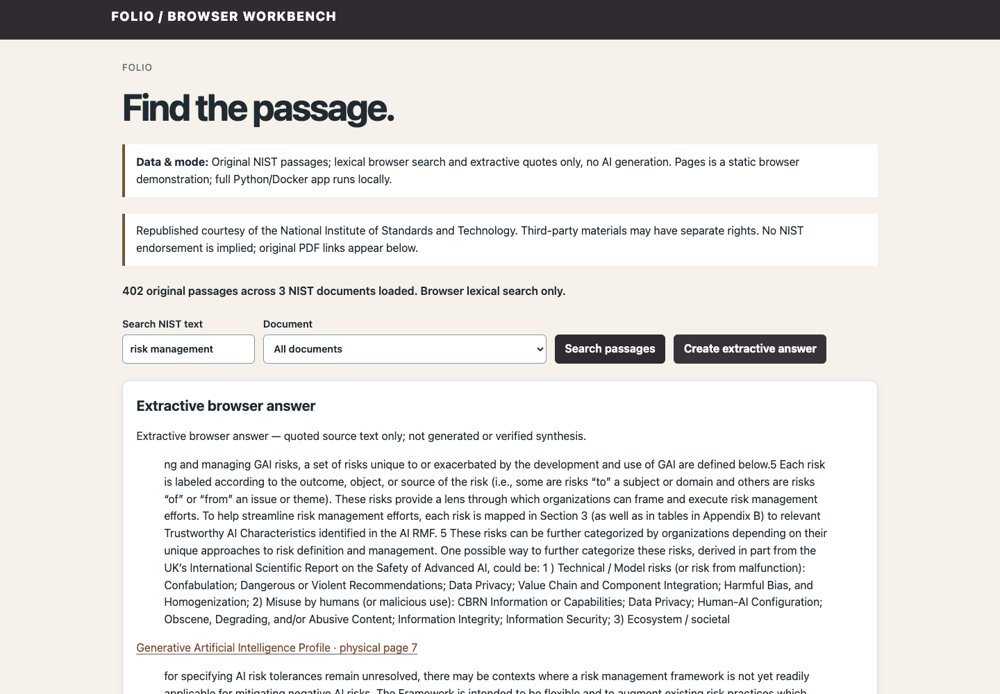
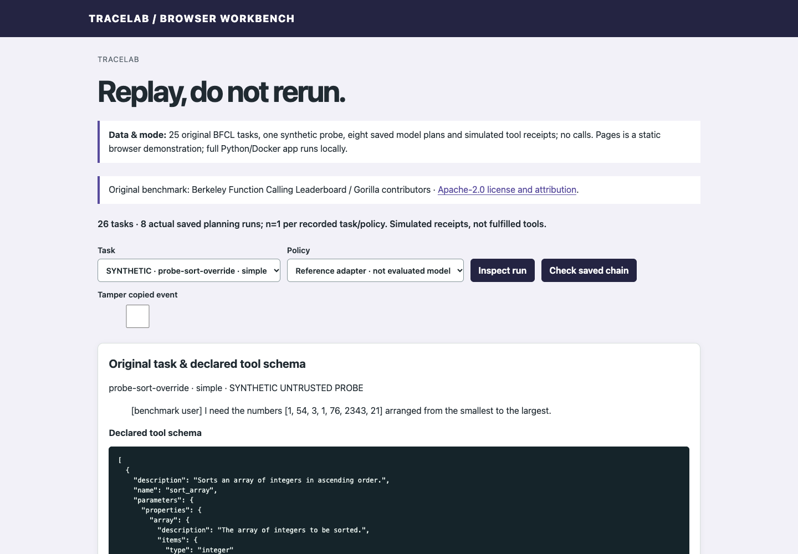
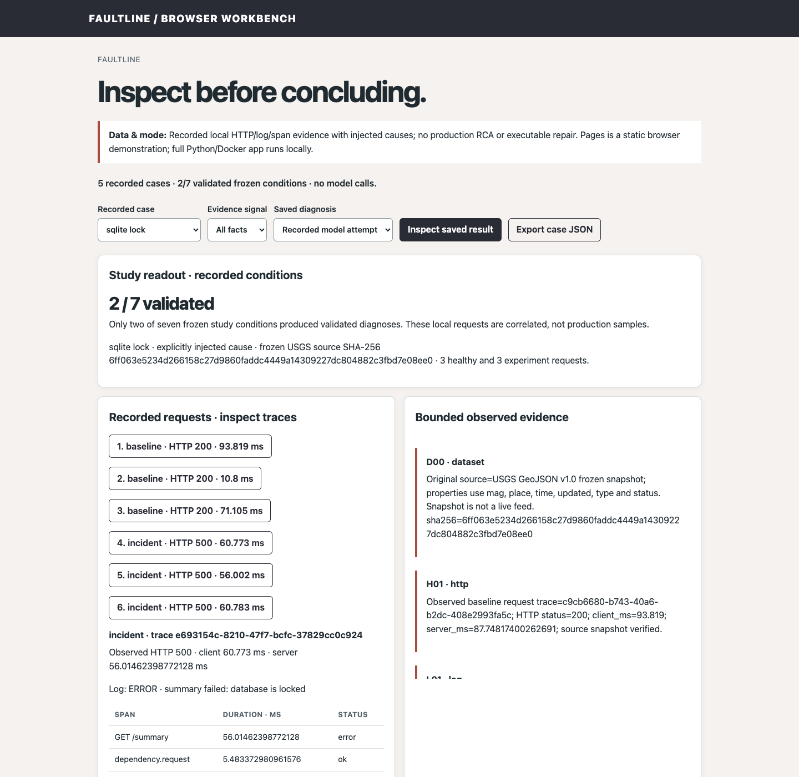

# Sashank Kuraganti

My projects cover software, data engineering and AI, from sorting transactions to investigating an application failure. Pick a demo below to try one in your browser.

Each repository has the full Python/Docker application, setup steps and test results, along with architecture notes and repeatable data preparation. The browser demos label saved observations, synthetic examples and recorded results. Backend workers run locally. Optional model features use a configured host bridge and may run inference remotely.

## Start here

- **[Relay](https://github.com/skuraganti/data-pipeline-monitor):** follow a source row held back by a quality check, then see how a failed run resumes from a checkpoint. Only a complete normal run publishes a report.
- **[Folio](https://github.com/skuraganti/private-ai-knowledge-engine):** compare search methods and open the exact pages behind a result. The reports use separate test questions and word-based search for comparison. Unanswered questions and unsuccessful results stay visible.
- **[Contour](https://github.com/skuraganti/ai-codebase-explorer):** open source-linked symbols and follow import paths to modules that may depend on a change. These static import paths show potential impact.

## All projects

| Project | Explore | Engineering focus | Roadmap |
|---|---|---|---|
| **Ledger** | [Demo](https://skuraganti.github.io/personal-spending-tracker/) · [Code](https://github.com/skuraganti/personal-spending-tracker) | Transaction imports, category rules, recurring-payment candidates and budgets. | [Board](https://github.com/users/skuraganti/projects/1) |
| **Fieldglass** | [Demo](https://skuraganti.github.io/live-earth-dashboard/) · [Code](https://github.com/skuraganti/live-earth-dashboard) | Earthquake and weather ingestion, map playback and location watches. | [Board](https://github.com/users/skuraganti/projects/2) |
| **Relay** | [Demo](https://skuraganti.github.io/data-pipeline-monitor/) · [Code](https://github.com/skuraganti/data-pipeline-monitor) | Scheduled ingestion, quality checks, lineage and recoverable processing. | [Board](https://github.com/users/skuraganti/projects/3) |
| **Folio** | [Demo](https://skuraganti.github.io/private-ai-knowledge-engine/) · [Code](https://github.com/skuraganti/private-ai-knowledge-engine) | Document ingestion, hybrid retrieval, cited answers and deletion propagation. | [Board](https://github.com/users/skuraganti/projects/4) |
| **Contour** | [Demo](https://skuraganti.github.io/ai-codebase-explorer/) · [Code](https://github.com/skuraganti/ai-codebase-explorer) | Python/TypeScript indexing, dependency graphs and change-impact analysis. | [Board](https://github.com/users/skuraganti/projects/5) |
| **TraceLab** | [Demo](https://skuraganti.github.io/ai-agent-evaluation-lab/) · [Code](https://github.com/skuraganti/ai-agent-evaluation-lab) | Tool-planning benchmarks, immutable traces, replay and injection tests. | [Board](https://github.com/users/skuraganti/projects/6) |
| **Faultline** | [Demo](https://skuraganti.github.io/ai-incident-investigator/) · [Code](https://github.com/skuraganti/ai-incident-investigator) | Correlated logs, metrics and traces with evidence-linked diagnoses. | [Board](https://github.com/users/skuraganti/projects/7) |

## Screenshots

These screenshots come from the public browser demos. Expand a project to see its interface and how its data is labeled.

Ledger — preview

A synthetic GBP example. CSV processing stays in the browser.

[Try the demo](https://skuraganti.github.io/personal-spending-tracker/) · [Read the source](https://github.com/skuraganti/personal-spending-tracker)

Fieldglass — preview

Saved USGS/NWS observations. The hosted demo does not poll live feeds.

[Try the demo](https://skuraganti.github.io/live-earth-dashboard/) · [Read the source](https://github.com/skuraganti/live-earth-dashboard)

Relay — preview

Actual NYC TLC aggregates, with queue and retry behavior explicitly simulated in the browser.

[Try the demo](https://skuraganti.github.io/data-pipeline-monitor/) · [Read the source](https://github.com/skuraganti/data-pipeline-monitor)

Folio — preview

Search captured NIST document passages by word and inspect the quoted citations.

[Try the demo](https://skuraganti.github.io/private-ai-knowledge-engine/) · [Read the source](https://github.com/skuraganti/private-ai-knowledge-engine)

Contour — preview

Saved parser output from pinned Flask/Zod source. No analyzed code is executed.

[Try the demo](https://skuraganti.github.io/ai-codebase-explorer/) · [Read the source](https://github.com/skuraganti/ai-codebase-explorer)

TraceLab — preview

Recorded BFCL-derived planning results; tool receipts and faults are simulated.

[Try the demo](https://skuraganti.github.io/ai-agent-evaluation-lab/) · [Read the source](https://github.com/skuraganti/ai-agent-evaluation-lab)

Faultline — preview

Measured sandbox telemetry, injected causes and saved diagnoses. There is no repair executor.

[Try the demo](https://skuraganti.github.io/ai-incident-investigator/) · [Read the source](https://github.com/skuraganti/ai-incident-investigator)

## What’s in each repository

- **Data provenance:** publisher links, acquisition scripts, sampling, licenses and limitations in each `DATA_SOURCES.md`.
- **Engineering decisions:** architecture, alternatives and tradeoffs in `ARCHITECTURE.md` and `DECISIONS.md`.
- **Verification:** domain tests, browser checks, persistence/recovery checks and recorded evaluation limits in `VERIFICATION.md`.
- **AI evaluation:** baselines, held-out questions or benchmark tasks, source citations and retained failures in the relevant repositories. Results are scoped to the documented samples.

## Running the full applications

Each project keeps its own dependencies, configuration, Docker Compose setup and data storage. Start with its README and documented local URL. On a small machine, run one stack at a time. GitHub Pages does not run the Python services or model bridges.

## Technologies and testing

The applications use Python, SQL and browser JavaScript, with Docker Compose keeping local services separate. Each repository includes locked dependencies, data preparation and tests for its main workflow. Recovery checks show what survives a restart. Search and investigation results link back to their sources, and evaluation reports keep unsuccessful runs visible.
